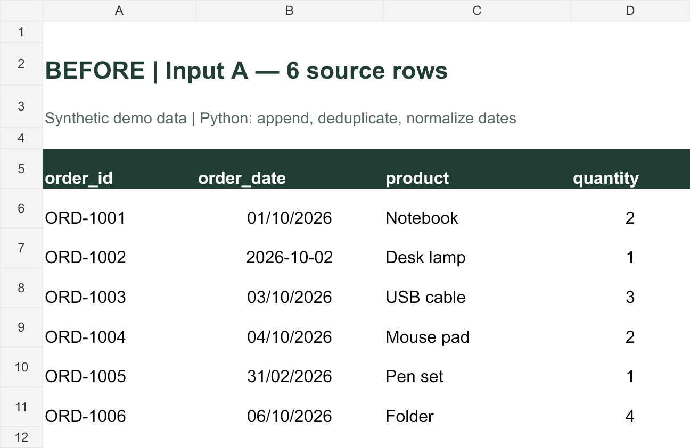
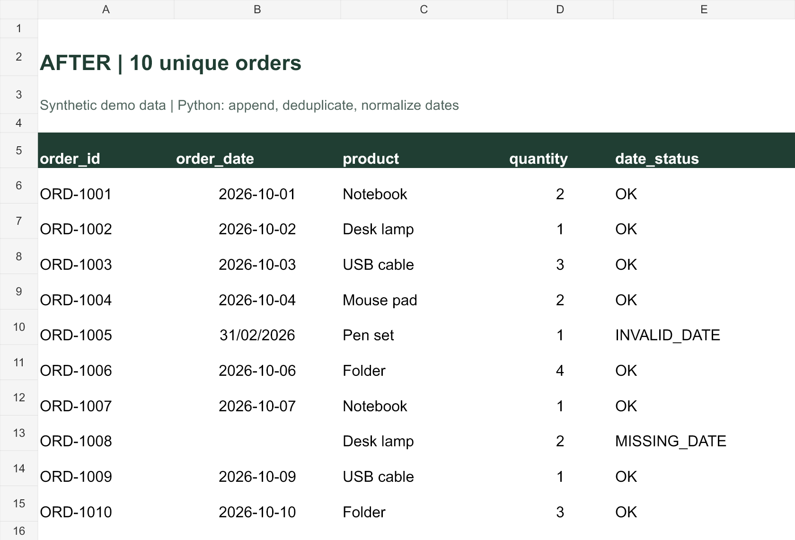

# CSV Cleaning with Python

Combine matching CSV exports, remove exact duplicates, and normalize dates with a small, repeatable Python script.

**Synthetic data only.** This is a working portfolio demo, not client work. It uses Python 3.10+ and the standard library: no packages, API keys, or network access are required.

## Before and after

Two overlapping exports contain 12 rows. The script produces 10 unique orders, removes 2 exact duplicates, and flags 2 date issues without guessing missing values.

| Check | Result |
| --- | --- |
| Input files / rows | 2 / 12 |
| Unique output rows | 10 |
| Exact duplicates removed | 2 |
| Dates converted to ISO format | 6 |
| Already-ISO dates retained | 2 |
| Invalid / missing dates flagged | 1 / 1 |

### Before: export A



### Before: export B


### After: cleaned output



These images are spreadsheet renders of the actual sample inputs and output. They are static presentation assets; the Python script generates CSV, JSON, and HTML, not images or Excel workbooks.

## Run the demo

Download this repository, extract it, and open a terminal in its folder. Run:

```bash
python clean_csv.py --inputs inputs/orders_a.csv inputs/orders_b.csv --output results
```

On Windows, you can use `py` instead of `python`. Use a new output directory for each run; existing directories are deliberately not overwritten. Inputs are never modified.

Open `results/before.html` and `results/after.html` in a browser to inspect the generated tables. GitHub displays HTML source rather than a live page; download the files to view them locally.

## Three processing rules

1. **Append matching tables** in the supplied file order.
2. **Deduplicate by `order_id`.** Exact repeated rows are removed and logged; the first occurrence is kept. A repeated ID with different field values stops processing for human review, even if the dates might mean the same day.
3. **Normalize dates** from `DD/MM/YYYY` or `YYYY-MM-DD` to `YYYY-MM-DD`. Slash dates are explicitly day-first: `01/10/2026` means 1 October. Invalid and blank dates retain their original value and receive `INVALID_DATE` or `MISSING_DATE` flags.

## Deliverables

| File | Purpose |
| --- | --- |
| `cleaned.csv` | Combined data with an added `date_status` column |
| `audit.csv` | Removed duplicates and date issues, including source file and record location |
| `report.json` | Processing counts |
| `before.html` / `after.html` | Readable views generated from the data |

Checked sample outputs are included in [examples](examples). Source-row numbers in the audit count CSV records starting at 2 after the header; embedded newlines can make them differ from physical file line numbers.

## Input contract and limitations

- This demo reads **CSV only**, not XLSX. CSV output can be imported into Excel.
- UTF-8 CSV, optionally with a BOM, using comma delimiters.
- One or two files, at most 5,000 data rows and 10,000,000 bytes combined.
- These four columns are required in this exact order: `order_id,order_date,product,quantity`.
- Order IDs must be nonempty and must not have surrounding whitespace.
- Product and quantity values are preserved, not validated or trimmed.
- No scraping, APIs, databases, workbook formulas, macros, GUI, or hosting.
- The HTML explanatory text and synthetic-data labels are tailored to the supplied sample. Adapt those labels before using the script for another dataset.
- CSV cell contents are preserved. This demo does not sanitize formula-like values for spreadsheet applications; review untrusted files before opening them in Excel.

## Tests

```bash
python -m unittest -v test_clean_csv.py
```

Tests cover the expected sample result, repeatability, conflicting duplicate IDs, missing IDs, incorrect columns, malformed rows, row limits, date boundaries, and invalid file count. Test fixtures are synthetic and temporary directories are cleaned up automatically.

## Need help with your files?

I offer a focused **$29 Excel/CSV cleaning package on Upwork**:

- Up to 2 files with identical columns and one values-only table per file.
- Up to 5,000 rows total, 30 columns, and 10 MB combined.
- Up to 3 agreed cleaning rules.
- Cleaned CSV or XLSX, reusable Python source, dependency list, English run guide, and validation report.
- 3-day delivery after the required inputs are provided, with 1 revision within the agreed scope.

[View the package and current scope on Upwork](https://www.upwork.com/services/product/development-it-clean-excel-or-csv-files-and-a-reusable-python-processing-script-2111920403466705675)

The service can cover agreed XLSX tasks; this repository demonstrates CSV processing only. Message me on Upwork with an anonymized sample if you are unsure whether your task fits. New input structures or additional rules require a scope review. The live listing controls current pricing and terms.

## Development note

Built with AI-assisted coding, review, and automated tests. All included records are synthetic. No client files, credentials, or private account information are included. Private client materials will not be sent to external AI services without prior permission.
